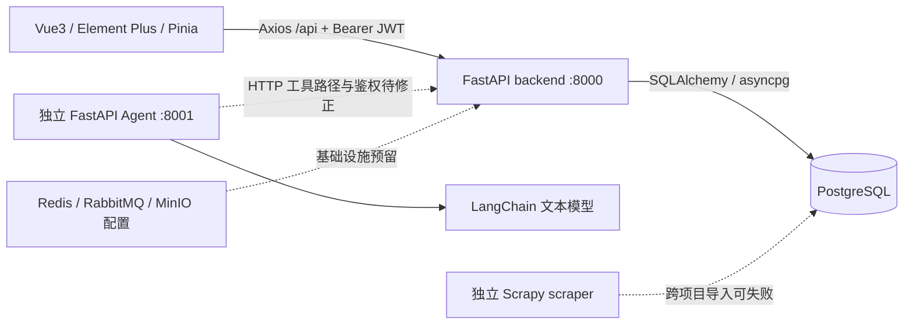

# TikTok Shop AI 智能选品模块：代码审计与实施计划

审计日期：2026-10-13（Asia/Shanghai）
主项目：`D:/VibeCoding/tiktok-ecommerce-automation-system`
参考项目：`D:/VibeCoding/tk-autopilot`

## 1. 结论与范围

主项目具备可复用的 Vue3 + Element Plus 管理界面、FastAPI JWT 登录链路、SQLAlchemy 异步 PostgreSQL 连接、商品 CRUD 和 `draft` 状态。适合在现有后台内独立增加智能选品模块，无需迁移到参考项目的 Express/SQLite 架构。

当前没有贯通后台的商品候选池、视觉 AI 评估、人工选品审核、持久化分析任务及独立上架草稿。存在真实**文本**模型请求代码，但代码存在不代表本地已调用成功；本地启动脚本明确关闭真实 AI。参考项目存在真实百炼视觉请求实现，DeepSeek 仅预留配置，没有实际调用。

实施前需处理与新增模块直接相关的基础问题：Alembic 两个独立 head、测试引用空 metadata、AI 失败降级为规则评分、现有本地商品状态与平台真实发布状态混用。不得把已有模拟评分、模拟商品和本地 `listed` 状态作为真实运营证明。

本轮仅做代码审计、基线验证和本文档，不实现第二至第五阶段，不调用付费模型、不运行爬虫、不执行数据库迁移、不修改登录/商品/订单业务代码。审计开始时工作区已存在本地启动相关修改，均予保留。

证据分为：**代码确认**、**本地运行验证**和**待验收**。未以 README、接口注释或需求文档代替实现证据；未读取或输出私有 API Key、Cookie、Token 内容。

## 2. 实际架构

图中虚线表示代码中的可选或未贯通依赖，不表示已经正常工作的调用链。

| 部分 | 实际实现 | 审计判断与入口 |
|---|---|---|
| frontend | Vue 3、TypeScript、Vite、Vue Router、Pinia、Element Plus、Axios、ECharts | `frontend/package.json`、`src/router/index.ts`、`src/layouts/DefaultLayout.vue`；没有智能选品导航或页面 |
| backend | FastAPI，路由在 `/api/v1`；健康检查单独为 `/v1/health` | `backend/app/main.py`、`app/api/v1/router.py`；主要 CRUD 直接在路由中执行数据库操作 |
| 登录 | bcrypt 密码哈希、JWT access/refresh token、数据库用户检查 | `backend/app/core/security.py`；登录、商品、订单实际使用此实现 |
| 数据库 | SQLAlchemy 2.0 async + asyncpg；UUID、JSONB、Numeric，ORM 注册 23 张表 | `backend/app/core/database.py`、`app/models/base.py`、`app/models/__init__.py` |
| agent | 独立 FastAPI + LangGraph，文本选品、素材、定价、上架等节点 | `agent/app/main.py`、`app/graph/workflow.py`；未与当前选品前端贯通 |
| scraper | Scrapy 搜索/详情 spider，HTML parser，清洗/去重/JSON/数据库 pipeline | `scraper/scraper/spiders/alibaba.py`、`pipelines/`；不是授权平台适配器 |
| 基础设施 | Compose 声明 PostgreSQL 15、Redis 7、MinIO、RabbitMQ | `docker-compose.yml`；配置声明不等于已启动可用的任务系统 |
| 本地启动 | 项目内 Python venv、嵌入式 PostgreSQL、Uvicorn、Vite | `scripts/start-local.ps1`：数据库 `tiktok_ops_local` 位于 127.0.0.1:5433；后台 8000，前端 3000；不启动 Agent |

本地脚本设置 `LLM_MOCK_MODE=true`、`AI_ENABLE_MOCK_AI=true`、`TIKTOK_SHOP_MOCK_MODE=true`、`ALIBABA_1688_MOCK_MODE=true`。不能通过修改这些全局开关，让新选品模块同时改变已有客服、履约或发布行为。

## 3. 前端路由、请求与页面

### 3.1 已注册路由

来源：`frontend/src/router/index.ts`。

| 路径 | 页面 | 当前功能 |
|---|---|---|
| `/login` | `LoginView.vue` | 登录 |
| `/` | `DefaultLayout.vue` | 受保护布局，重定向 `/dashboard` |
| `/dashboard` | `DashboardView.vue` | 统计、趋势、最近订单 |
| `/products` | `ProductsView.vue` | 关键词/状态筛选、分页、新建、编辑、软删除、本地上/下架状态修改 |
| `/orders` | `OrdersView.vue` | 订单列表、详情、状态修改 |
| `/fulfillment` | `FulfillmentView.vue` | 采购单及运单展示 |
| `/customer-service` | `CustomerServiceView.vue` | 客服会话及消息 |
| `/finance` | `FinanceView.vue` | 财务统计及记录 |

`PlaceholderView.vue` 存在，但未注册到上述路由。左侧菜单在 `DefaultLayout.vue` 中显式定义，可增加“智能选品”“选品审核”，沿用表格、筛选卡片、标签、弹窗和分页样式。

### 3.2 可复用请求链与实际缺口

- `frontend/src/api/request.ts`：默认 baseURL `/api`、30 秒超时、自动附加 Bearer token、响应解包；401 清理登录并跳转。可新增独立 `api/sourcing.ts`。
- `frontend/src/stores/user.ts`：登录、用户信息、退出；路由守卫检查本地 token 是否存在，最终权限仍由后端验证。
- `frontend/vite.config.ts`：代理 `/api`、`/v1`、`/docs`、`/openapi.json` 到后端。
- 请求拦截器将 5xx 统一显示为“服务器内部错误”。新增模块应从失败任务响应展示具体原因，并对模型上游 401 使用业务错误码，避免错误地把平台模型鉴权失败当作用户登录过期。
- 当前商品列表/详情 API 未返回 `ProductImage`，商品页没有图片、推荐理由或风险展示；需要通过新选品 DTO 和草稿详情补充。
- `api/index.ts` 有未贯通函数：`generateMaterials()` 请求 `POST /v1/products/{id}/materials`，实际生成接口为 `/v1/materials/products/{id}/materials/generate`；`listingProduct()` 请求 `/v1/products/{id}/listing`，后端未注册该路由。
- 前端 `healthCheck()` 经 `/api` baseURL 请求 `/api/v1/health`，实际健康路径是 `/v1/health`。
- 商品编辑提交成本和状态，但 `ProductUpdate` 不含 `cost_price`；新建提交状态，但 `ProductCreate` 不含 `status`，额外字段默认被忽略。不能把既有表单当作完整草稿编辑能力。

## 4. 实际后端接口清单

通过导入 `app.main.app` 枚举实际注册路由确认；以下包含 34 个业务操作及 1 个健康检查，不包含框架文档路由。除健康检查外表中均使用完整 `/api/v1` 路径。

| 方法 | 路径 | 实际行为 / 限制 |
|---|---|---|
| GET | `/v1/health` | 返回应用环境和健康标识，不检查数据库/队列/模型 |
| POST | `/api/v1/auth/login` | 数据库用户校验及 JWT 签发 |
| POST | `/api/v1/auth/register` | 创建 operator 用户，返回 201 |
| POST | `/api/v1/auth/refresh` | 解码 refresh token 并签发 access token |
| GET | `/api/v1/auth/me` | JWT 校验及用户查询 |
| GET | `/api/v1/products` | 关键词/状态/分页查询数据库 |
| POST | `/api/v1/products` | 新建 Product，当前默认返回 200 |
| GET | `/api/v1/products/{product_id}` | 商品详情；未带图片/SKU/素材 |
| PUT | `/api/v1/products/{product_id}` | 更新字段；状态字符串未限定流转 |
| GET | `/api/v1/orders` | 状态/订单编号/分页筛选 |
| GET | `/api/v1/orders/{order_id}` | 订单详情 |
| PUT | `/api/v1/orders/{order_id}/status` | 直接更新状态和备注，未使用完整状态机/历史记录 |
| POST | `/api/v1/materials/translate` | TranslationService 文本翻译，默认模拟 |
| POST | `/api/v1/materials/image-translate` | 引用不存在的 `image_translation_service.py`，不是可用视觉选品接口 |
| GET | `/api/v1/materials/products/{product_id}/materials` | 读取 Material |
| POST | `/api/v1/materials/products/{product_id}/materials/generate` | TODO，返回 `mock-task-id`，未生成/保存素材 |
| POST | `/api/v1/pricing/calculate` | 本地成本公式，固定示例汇率 |
| GET | `/api/v1/pricing/suggestions` | 固定建议价/竞品示例数据 |
| POST | `/api/v1/listing/match-category` | 固定品类候选列表 |
| GET | `/api/v1/fulfillment/purchase-orders` | 数据库采购单列表 |
| POST | `/api/v1/fulfillment/purchase-orders` | 创建本地采购单，非真实 1688 下单证明 |
| GET | `/api/v1/fulfillment/shipments` | 数据库运单列表 |
| GET | `/api/v1/customer-service/sessions` | 使用占位鉴权依赖 |
| POST | `/api/v1/customer-service/sessions` | 创建会话，未声明用户鉴权依赖 |
| POST | `/api/v1/customer-service/messages` | 消息及客服处理，未声明用户鉴权依赖 |
| GET | `/api/v1/customer-service/sessions/{session_id}` | 会话详情，未声明用户鉴权依赖 |
| POST | `/api/v1/customer-service/sessions/{session_id}/end` | 结束会话，未声明用户鉴权依赖 |
| POST | `/api/v1/customer-service/sessions/{session_id}/transfer` | 转人工，未声明用户鉴权依赖 |
| GET | `/api/v1/customer-service/faqs` | FAQ 搜索，未声明用户鉴权依赖 |
| GET | `/api/v1/finance/summary` | 聚合 FinanceRecord |
| GET | `/api/v1/finance/transactions` | 财务记录分页 |
| GET | `/api/v1/dashboard/stats` | 数据库统计；空数据库时返回演示统计，趋势含模拟值 |
| GET | `/api/v1/dashboard/recent-orders` | 最近订单查询 |
| GET | `/api/v1/dashboard/sales-trend` | 销售统计；全零时返回演示趋势 |
| GET | `/api/v1/dashboard/order-status-distribution` | 订单分布；空数据时返回演示值 |

聚合入口为 `backend/app/api/v1/router.py`。`modules.py` 内还有 `cs_router`，但没有挂载；已挂载的客服路由来自 `customer_service.py`。

登录、商品、订单、素材、定价、履约、财务、仪表盘的受保护接口使用 `app.core.security.get_current_user`。`app.api.deps.get_current_user` 仅检查 Bearer 结构并返回 `current_user_placeholder`，被客服列表实际使用。新模块必须明确导入真实 JWT 依赖；本轮不扩大修改范围去重构客服。

## 5. 数据库模型与迁移状态

### 5.1 已注册的 23 张业务表

所有业务模型继承 `app.models.base.Base`，带 UUID `id`、`created_at`、`updated_at`。以下主要字段仅列审计相关部分，完整定义见相应源文件。

| 文件 | 模型 / 表 | 主要字段及可复用点 |
|---|---|---|
| `models/user.py` | User / `users`；Role / `roles` | 用户身份、角色字符串、密码哈希、启用状态；可关联导入人/审核人 |
| `models/product.py` | Product / `products` | 名称、描述、成本/售价、category_id、supplier_id、status、score、source_url、source_product_id、tiktok_product_id |
| 同上 | ProductSKU / `product_skus` | product_id、sku_code、JSONB specs、成本/售价、库存 |
| 同上 | ProductImage / `product_images` | product_id、url、image_type、sort_order |
| 同上 | Category / `categories` | 品类名称、父级、TikTok 品类 ID |
| 同上 | Supplier / `suppliers` | 供应商编码、名称、地域、评级 |
| `models/material.py` | Material / `materials` | 商品文本/图片素材、语言、content、file_url、JSONB metadata |
| `models/order.py` | Order / `orders` | TikTok 订单编号、状态、金额、货币、买家、地址、物流单号 |
| 同上 | OrderItem / `order_items` | 订单/商品关联、SKU、数量、单价、小计 |
| 同上 | OrderStatusHistory / `order_status_history` | 状态变更、操作人、备注 |
| `models/fulfillment.py` | PurchaseOrder / `purchase_orders`；Shipment / `shipments`；Forwarder / `forwarders` | 采购、运单、货代；不是候选池或上架草稿 |
| `models/finance.py` | FinanceRecord / `finance_records`；ExchangeRate / `exchange_rates` | 财务记录与人工/来源汇率；公式可使用显式业务参数 |
| `models/customer_service.py` | CSSession / `cs_sessions`；CSMessage / `cs_messages`；Ticket / `tickets` | 客服会话、消息、工单 |
| `models/mapping.py` | SKUMapping / `sku_mappings`；MatchRecord / `match_records` | TikTok/1688 SKU 映射及履约匹配记录；不是选品审核 |
| `models/alert.py` | Alert / `alerts` | 异常、关联订单、通知及重试数据 |
| `models/faq.py` | FAQ / `faqs` | 问答、语言、关键词、规则、站点 |

`Product.status` 已定义 `draft/active/inactive/listed/delisted`，可在审核通过后创建 `draft` 商品。不能让未审核候选直接混入商品管理。

`Product.score` 为 `Numeric(3,1)`，`ProductUpdate.score` 限制 0–10；新视觉评分为 0–100，应保存在独立评估表。直接写 100.0 会超出字段可表示范围，且与旧评分语义不兼容。

### 5.2 已确认的问题

1. **两个 Base**：`app.core.database.Base` 与 `app.models.base.Base` 不同。运行检查显示业务 metadata 有 23 张表，前者为 0 张；测试夹具却导入前者。
2. **两个独立迁移 head**：`python -m alembic heads` 输出 `002` 和 `f950df57a1e2`。两个文件 `down_revision=None`，且重复创建 forwarders、sku_mappings、match_records、alerts、faqs。不能仅加 merge revision 后直接执行全部迁移。
3. **本地数据库没有迁移版本**：只读核对 `tiktok_ops_local`，存在上述 23 张业务表，没有 `alembic_version`。与本地 bootstrap/seed 通过 ORM 建表的代码一致。
4. **SQLite 不能等价验证此 schema**：测试使用 SQLite，真实业务表含 PostgreSQL JSONB；即使改对 Base，仍需 PostgreSQL 测试库或明确的类型适配。推荐独立 PostgreSQL 测试库。
5. `infra/postgres/init.sql` 只创建扩展/设置时区，不创建业务表。

迁移方案应先只读检查部署库及约束，分别设计空库初始化和已有 ORM 建表库的基线接管，在独立测试库验证，再添加选品表。没有完整 schema 校验前不得直接 stamp、删表、重建现有库或改写已执行迁移。

## 6. AI 调用现状

| 位置 | 真实请求代码 | 配置与默认行为 | 能否直接用于新模块 |
|---|---|---|---|
| `backend/app/services/translation_service.py` | `AsyncOpenAI.chat.completions.create()`，文本翻译、重试 | `core/ai_config.py` 的 `AI_OPENAI_*`、`AI_ENABLE_MOCK_AI`；默认模拟 | 可参考 SDK 请求/重试，不能沿用模拟成功 |
| `intent_service.py`、`sentiment_service.py`、`response_generator.py` | AsyncOpenAI 文本分类/情绪/回复 | `OPENAI_API_KEY` + `LLM_MOCK_MODE`；无 key 或 mock 开启时规则/模拟 | 不承担视觉分析；部分失败返回通用回复/规则结果 |
| `agent/app/services/llm_service.py` | ChatOpenAI + `ainvoke`，可绑定 JSON 输出 | `LLM_API_KEY`、`LLM_MODEL`、`LLM_BASE_URL`、`LLM_TEMPERATURE`；此服务没有自己的 LLM mock 开关 | 可参考接口，当前只构造文本消息，缺少视觉输入与 schema 校验 |
| `agent/app/services/selection_service.py` | 调用上项文本 JSON 接口 | 失败返回 `_fallback_score()` 规则评分 | 不能把降级分标记为真实 AI 评估 |
| 主项目视觉/DeepSeek/ModelProvider | 未找到实际接入 | 无独立选品配置 | 需要新增 |
| `tk-autopilot/src/ai/vision.js` | Axios POST 百炼兼容接口，传图片 data URL 与商品文字 | 环境变量 `QWEN_API_KEY`；参考默认配置 `qwen3-vl-flash`；未在本轮验证可用性 | 可参考视觉消息和提示词；必须重写错误传递/校验 |
| `tk-autopilot/src/ai/aestheticLearning.js` | Qwen 文本审美画像生成 | 记录人工偏好，生成画像 | 后续可选能力，不是首期闭环必要项 |
| `tk-autopilot` DeepSeek | 仅 configLoader 的 key 和配置状态展示 | `DEEPSEEK_API_KEY`，未看到请求调用 | 实际功能缺失 |

主项目 backend Settings 同时存在 `OPENAI_API_KEY`、`LLM_API_KEY`、独立 `AI_` 配置，且 `llm_model/base_url/temperature` 重复声明。已有客服客户端未传 Settings 中的 `llm_base_url`。新模块应使用独立服务端配置，避免继承这些不一致的开关。

**本轮未完成真实图片分析**，也未验证任一外部模型凭证。真实模型验收属于后续实施阶段，必须以成功上游请求、有效结构化响应和持久化证据证明，不能由现有代码或 UI “configured” 状态推断。

## 7. Agent、scraper 和参考项目的实际限制

### 7.1 Agent

代码注册独立接口：`GET /health`；`POST /api/v1/agent/run`、`/full-workflow`、`/selection`、`/material`、`/pricing`、`/listing`；`GET /api/v1/tiktok/categories`、`/orders`；`POST /api/v1/tiktok/match-category`。没有声明与后台相同的用户 JWT 鉴权。

`graph/workflow.py` 实际为 master → 按 task_type 选择单个节点 → END。`/full-workflow` 将 task_type 设置为 listing，不会执行注释描述的 selection → material → pricing → listing 全链路；也没有人工审核暂停点或数据库检查点。

`tools/backend_tools.py` 默认 base URL 已含 `/api/v1`，工具路径又附加 `/v1/products` 等，形成 `/api/v1/v1/...`；同时未传用户/服务鉴权。`material_service.py` 生成失败返回占位标题/描述。Agent 不能作为现成的可靠选品工作流直接接入。

### 7.2 scraper

- 有 1688 搜索/详情 HTML 解析、Playwright 标记、模拟数据生成、清洗及去重代码；授权接口适配能力未实现。
- settings 将 `ROBOTSTXT_OBEY=False`，配置了代理/User-Agent 中间件；本轮不运行、不迁移这些页面采集能力。
- settings 的 `ALIBABA_1688_MOCK_MODE` 默认为 true，但搜索 spider 构造参数 `mock_mode=False`，且没有读取此 setting；CLI 的 `--mock` 才显式传参。字符串参数未统一转换为 bool，不能仅凭环境开关认定执行模式。
- 数据库 pipeline 直接向 `products` 写入草稿，`rating` 写入 `Product.score`，不是 AI 评分；Item 无明确模拟/真实来源标签。
- `_project_root` 实际指向 scraper 根目录，尝试导入 `backend.app.*`，而 backend 内部又用 `app.*`；异常时静默禁用数据库 pipeline。Docker scraper 只复制 scraper，自身不包含 backend。
- 更新已有商品时继续追加 SKU/图片，缺少幂等去重；入库异常日志后仍返回 Item。不能作为新候选池持久化闭环直接使用。
- Compose 配置 `celery -A scraper.tasks worker`，实际仓库没有 `scraper/tasks.py`。后端物流 `shared_task` 是零散代码，未发现可直接复用的完整选品 worker 注册/运行链；其中还使用 Settings 不存在的 `DATABASE_URL` 大写属性。

### 7.3 tk-autopilot：借鉴范围

参考项目是 Express + 原生 HTML/CSS/JS + sql.js SQLite + Playwright，并非 Vue3/FastAPI 模块。

| 参考能力 | 可以借鉴 | 需要替换或排除 |
|---|---|---|
| `src/ai/vision.js` | 图片与文字组合输入、东南亚适配/图片质量/差异化等评分维度 | 捕获错误后返回 null，接口仅报告“视觉评分失败”；JSON 正则解析而无严格类型/范围校验；不限图片下载大小，需重新设计 |
| `src/ai/filter.js` | 将规则评分和视觉评分分别展示的思路 | 60% 视觉 + 40% 规则混合；视觉失败退回规则分，不能作为真实 AI 分数 |
| `src/shared/productSchema.js` | 多来源统一 DTO | 使用 `|| 0` 掩盖缺失成本等数据，新模块应保留未知值 |
| `src/db/schema.sql`、`src/api/routes.js` | 候选、规则、审核、草稿分层的业务思路 | 不搬 SQLite、弱鉴权和产品状态覆盖；审核队列未完整持久化视觉评估证据 |
| `src/shared/progressManager.js` | 状态/进度/消息展示 | 内存共享状态，按平台而非任务隔离；重启丢失，需 PostgreSQL 持久化 |
| `src/api/alibaba.js` | 授权 API 适配器边界思路 | 缺凭证/请求失败自动退回 mock，必须改成明确不可用/失败 |
| `platforms/alibaba1688/`、`platforms/miaoshou/` | 仅帮助理解运营字段 | 排除页面抓取、登录 Cookie 和浏览器自动发布代码 |

参考接口 `/api/products/search` 默认走浏览器搜索；`/api/vision-score`、`/vision-score-batch` 提供同步视觉评分；`/review/add`、`/review/list`、`/products/:id/approve`、`/skip` 持久化审核状态；`/listing/start`、`/listing/complete` 可以仅通过改本地状态模拟完成发布。不得将这些发布行为搬进新模块。

## 8. 可复用模块与缺失能力

| 能力 | 决策 |
|---|---|
| Vue 布局/菜单/表格/筛选/分页/通知 | 直接复用样式与组件模式，增加两个独立页面 |
| JWT、User、数据库会话、通用分页 | 直接复用真实实现；用户归属/审核权限在新接口校验 |
| Product、ProductImage、Category、Supplier、Material | 审核通过后复用；新 AI 信息保存在专表，不改变旧 score 语义 |
| `ProductService` | 可复用查询方法；其 create/update 内部 commit，不适合原样用于审核+草稿的原子事务，需由新服务统一事务/flush |
| Translation/LLM 请求代码 | 参考请求与重试模式；新建独立 ModelProvider，禁用模拟与静默降级 |
| 定价公式、ExchangeRate | 可作为明确标注的人工成本估算；当前硬编码费率/汇率/竞品数据不是实时市场信息 |
| 1688/TikTok 客户端 | 部分 API 调用骨架可参考；配置不一致、mock/TODO 不能作为已授权可用能力 |
| Redis/RabbitMQ/Celery 配置 | 基础设施可选；选品任务执行器必须明确实现并验证，不假定已有 worker 可用 |

缺失的核心能力：合法导入与来源溯源、候选池及筛选、百炼视觉 provider、DeepSeek 文本 provider、严格结构化 JSON、任务持久化/超时/重试、AI 失败原因展示、版本绑定的审核日志、幂等草稿转换、前端流程、关键接口及真实模型验收。

## 9. 实施计划（后续阶段，尚未实现）

### 9.1 先建立兼容边界与测试基线

1. 保持现有登录 API/token、商品/订单路由和响应字段；新模块放在 `/api/v1/sourcing` 与独立 services/schemas/model 文件中。
2. 修正测试 metadata 及独立 PostgreSQL 测试库配置，补齐 pytest/pytest-asyncio 依赖；记录旧测试预期与实际行为差异。
3. 解决迁移多 head、重复建表和现有 ORM 建表库接管；在空库与已有 schema 的测试副本验证。新迁移仅新增表/索引及必要兼容字段。
4. 独立配置选品 provider，避免启动新功能时把已有客服/履约/平台 mock 关闭。

### 9.2 数据模型与合法导入

优先使用现有 PostgreSQL 和 `app.models.base.Base`，建议新增：

| 模型 / 建议表名 | 核心字段与约束 |
|---|---|
| SourcingCandidate / `sourcing_candidates` | 来源类型、链接/来源商品 ID、导入人、标题、图片、成本及币种、品类、目标站点、原始数据 JSONB、授权/来源说明、数据标识、版本号；来源+商品/链接去重 |
| AIAnalysisTask / `sourcing_analysis_tasks` | candidate_id、输入版本/快照、provider/model、queued/running/succeeded/failed、尝试次数、时间、错误码/安全错误说明、request_id；按任务隔离和重试 |
| AIEvaluation / `sourcing_ai_evaluations` | task_id、candidate_id、图片视觉分、推荐理由、风险、品类、英文标题、市场建议 JSONB、provider/model/prompt/schema 版本、usage、输入快照/图片摘要；仅真实且校验成功才生成有效评估 |
| SourcingReview / `sourcing_reviews` | candidate_id、evaluation_id、输入版本、审核人、approve/reject、备注、时间；不可覆盖旧记录 |
| ListingDraft / `sourcing_listing_drafts` | candidate_id、review_id、product_id、站点、英文标题/描述/图片、成本/建议售价、draft 状态；候选+站点唯一或显式版本约束，防重复生成 |

用独立字段区分 `manual / authorized_api / fixture` 来源，以及来源验证状态。人工提交数据仅标记“用户提供”，不能自动标记“平台已验证”。测试数据不得进入运营队列或草稿审批路径。

首期支持人工填写 1688 链接及商品字段、合法来源 JSON/CSV 批量导入。**只有链接时不自动抓取**；缺少图片或关键字段应显示“待补充”，拒绝执行无依据的视觉分析。预留 `SourceAdapter`：Manual、AlibabaAuthorized、MiaoshouAuthorized；未配置授权的适配器返回明确的未启用状态，不生成模拟商品。

关键词、站点、品类、最低/最高价格是在候选池内筛选，不表示已经执行平台实时搜索。

### 9.3 ModelProvider 与结构化结果

统一接口建议提供 provider 名称、视觉能力声明、`analyze_image()`、`analyze_text()`、健康/配置状态。实现 BailianVisionProvider 和可选 DeepSeekTextProvider。DeepSeek 接收商品文字及已有视觉证据，不能单独生成或覆盖“图片视觉评分”。

服务端环境变量建议：`SOURCING_VISION_PROVIDER`、`BAILIAN_API_KEY`、`BAILIAN_BASE_URL`、`BAILIAN_VISION_MODEL`、`SOURCING_TEXT_PROVIDER`、`DEEPSEEK_API_KEY`、`DEEPSEEK_BASE_URL`、`DEEPSEEK_MODEL`、超时/重试/并发限制。前端只获取 provider/model 名称和可用状态；没有 key 就明确报未配置。具体模型名称、区域接口和 JSON 能力在实施时按官方文档和实际账号验证，不能仅照抄参考默认值。

结构化 JSON 通过 Pydantic 严格校验，不以解析出任意 JSON 对象视为成功：

| 字段 | 类型与要求 |
|---|---|
| `product_name` | 非空字符串 |
| `visual_score` | 0–100 数值，来自真实视觉响应 |
| `recommendation_reasons` | 字符串数组 |
| `category` | 字符串；业务品类建议与平台官方 category_id 分离 |
| `potential_risks` | 风险项数组，区分观察、推断和需人工核实事项 |
| `english_title_suggestion` | 非空字符串 |
| `market_fit_suggestions` | 按目标站点给出建议、依据及局限的结构化数组 |

记录 provider/model、调用时间、输入版本、提示词/schema 版本、上游 request ID（若提供）和 usage（若提供）。视觉部分成功但可选文本失败时必须显示文本阶段失败，保留已完成视觉证据，按明确策略重试；不得把部分结果伪装成整项完成。

图片下载需要限制协议、目标地址/重定向、类型、大小、超时；不接受内网/本机 URL。合法商品文本和图片说明作为数据输入，不作为模型执行指令。输出不能凭空推断销量、利润、认证、知识产权或市场调查事实。

### 9.4 持久化任务与审核闭环

- 分析提交立即返回 202 + task_id，前端轮询任务/结果；数据库保存 queued → running → succeeded/failed，不靠 30 秒浏览器请求承载整个模型调用。
- 首期可采用 PostgreSQL 任务表 + 独立 worker 领取任务，使用锁/租约、并发上限、超时、重启恢复和有限退避；如使用 Celery，先实现真正的 app/worker/注册入口和投递失败补偿。
- provider 错误区分缺配置、图片不可读、上游鉴权/限流/超时、无效 JSON、schema 校验失败；持久化并在页面显示脱敏原因，不回填默认分数。
- 同一候选相同版本的重复提交应复用活动任务或拒绝重复；重试保留旧失败记录并关联新尝试，不覆盖历史。
- 候选状态与任务状态分离，避免“已导入”被误认为“AI 已完成”。修改图片/标题/成本/站点等输入后更新版本，旧分析与审核显示过期。
- 审核通过仅允许真实成功、与当前输入版本一致的评估；通过/拒绝必须记录审核人和所依据的 evaluation_id。
- 审核通过在一个事务内创建审核记录、ListingDraft、`Product(status='draft')`、图片/所需素材并建立关联；行锁/唯一约束保证并发通过与重复点击不产生多个商品。失败全部回滚。
- 商品管理增加“上架草稿”筛选/入口并展示选品来源和详情；保留既有普通商品功能。新生成草稿不自动调用 TikTok/妙手发布、不设置 `listed` 或生成虚构平台商品 ID。

建议接口（仅计划）：

| 方法 | 路径 | 用途 |
|---|---|---|
| POST | `/api/v1/sourcing/candidates/import` | 单条/批量合法数据导入，返回逐条校验结果 |
| GET | `/api/v1/sourcing/candidates` | 关键词/站点/品类/价格/状态筛选分页 |
| GET / PATCH | `/api/v1/sourcing/candidates/{id}` | 候选详情/补充输入，更新版本 |
| POST | `/api/v1/sourcing/candidates/{id}/analyze` | 发起分析，202 |
| GET | `/api/v1/sourcing/tasks/{id}` | 状态、阶段、失败原因及结果关联 |
| POST | `/api/v1/sourcing/tasks/{id}/retry` | 失败重试 |
| GET | `/api/v1/sourcing/reviews` | 待审核/历史审核列表 |
| POST | `/api/v1/sourcing/candidates/{id}/review` | 通过/拒绝，传 evaluation_id 与输入版本 |
| GET | `/api/v1/sourcing/drafts` | 上架草稿及商品关联 |
| GET | `/api/v1/sourcing/providers/status` | 脱敏配置状态，不暴露密钥 |

前端增加 `SourcingView.vue`、`SourcingReviewView.vue`，菜单“智能选品”“选品审核”。候选卡片/列表展示图片、币种成本、视觉评分、推荐理由、风险及数据来源；任务展示排队/执行/成功/失败、阶段、错误原因和重试。审核通过跳转商品管理草稿或提供明确入口。

### 9.5 测试与验收

关键接口测试应使用隔离 PostgreSQL，覆盖：鉴权及权限、非法来源/链接/价格/缺图、导入去重、筛选、真实响应 schema 的解析与范围、上游失败的错误传播及空评分、任务重试/恢复、候选修改导致评估失效、拒绝不建草稿、通过事务回滚、重复/并发通过幂等、测试数据隔离。模型响应 fixture 仅用于自动测试，并明确标记测试数据。

真实模型验收必须另外执行至少一次真实图片分析，保存脱敏调用证据，并实际完成前端导入/提交 → 后端任务 → PostgreSQL 任务/评估 → 人工通过/拒绝 → 商品管理草稿。核对刷新/重启后结果仍可读取，失败原因可见且可重试。不能把 ASGI mock 测试或本地图片占位数据作为真实模型验收。

回归现有登录、商品 CRUD、订单查询/状态接口，运行原有 backend/agent 测试、关键新接口测试与 `npm run build`。后续输出 `docs/AI_SOURCING_IMPLEMENTATION.md`，记录已实现范围、迁移方法、环境变量、实际测试结果和真实模型证据；没有凭证/合法商品图片/可访问模型时明确列出未验收项，不填写虚假成功。

## 10. 本轮验证结果

| 检查 | 实际结果 |
|---|---|
| 前端 `npm.cmd run build` | 通过，包含 vue-tsc 和 Vite production build；有既有大于 500 KB 的 chunk 警告。初次在沙箱遇到 realpath EPERM，权限审查允许后重跑通过 |
| 后端导入及路由枚举 | 成功，确认以上路由、真实 JWT/占位依赖使用位置 |
| ORM metadata 检查 | 业务 Base 23 表；测试引用的数据库 Base 0 表 |
| `python -m alembic heads` | 确认 `002`、`f950df57a1e2` 两个 head；未执行 upgrade/stamp |
| `backend: python -m pytest tests -q` | 未能运行：当前 `.venv` 无 pytest；pytest-asyncio、aiosqlite 也未安装 |
| `agent: python -m pytest tests -q` | 未能运行：同一环境无 pytest；未把失败标记为通过 |
| 本地 `GET /v1/health` | 200 |
| 未登录访问 me/products/orders | 均 403（当前 HTTPBearer 行为）；现有 auth 测试期望未登录为 401，与实际不一致 |
| 本地演示账号登录 + me/products/orders | 登录 200；三个受保护读取均 200；当前列表总数商品 29、订单 50。仅作为现状，不认定为真实运营数据 |
| 本地 PostgreSQL 只读 schema 核对 | `tiktok_ops_local` 23 张业务表，未发现 alembic_version；无增删改业务数据 |
| 真实模型图片分析 | 本轮未执行，留待实施验收 |
| 新选品前端→后端→数据库闭环 | 当前不存在，留待实施 |

后端现有商品新建测试还期望 201，而当前注册路由默认返回 200，这是静态确认的基线差异；本轮未安装测试依赖或改动旧测试/接口以掩盖差异。本地网络读取初次被沙箱 WinError 10013 阻止，经权限审查允许后完成只读探测。

审计交付仅新增本文件。关键阻塞是迁移/测试基线与真实 provider/任务/审核链路的缺失；现有后台和数据库可以保留并作为新模块基础。
